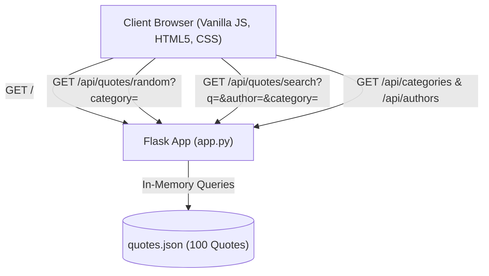

# SSL-Famous-Quotes 📜

[](https://www.python.org/)
[](https://flask.palletsprojects.com/)
[](https://developer.mozilla.org/en-US/docs/Web/JavaScript)
[]()
[](LICENSE)

A modern, responsive web application that showcases a curated archive of **100 well-known quotes** from history's most notable thinkers, scientists, writers, and leaders. Built with a **Python Flask** REST API and a **zero-dependency vanilla JavaScript / HTML5 / CSS** frontend.

---

## ✨ Features

- **🎯 Spotlight Hero Card**:
  - Automatically loads a random quote on launch.
  - **"Next Random Quote"**: Generates a new random quote with smooth fade transitions (respects any active category filter).
  - **"Copy" Button**: Instant one-click copy to clipboard with toast notification feedback.
  - **"Listen" Button**: Reads quotes aloud using the browser's native **SpeechSynthesis API** (Text-to-Speech).
- **🔍 Multi-Faceted Explorer & Search**:
  - **Live Search**: Instant keyword search matching across quote text, author name, and category with debounced input.
  - **Category Pills & Dropdown**: Filter quotes across 6 balanced categories (*Philosophy, Science & Tech, Literature, Leadership, Wisdom, Art & Creativity*).
  - **Author Filter**: Dropdown dynamically populated with all unique authors and their respective quote counts.
  - **Reset Filters**: One-click reset to restore the full catalog view.
- **⭐ Interactive Quotes Grid**:
  - Responsive card grid displaying all matching results.
  - **"⭐ Feature"**: Promotes any individual quote directly into the hero spotlight card with a smooth scroll.
- **⚡ Zero Frontend Dependencies**:
  - Pure vanilla JavaScript (ES6+), semantic HTML5, and custom CSS without React, Vue, jQuery, or Tailwind.

---

## 🏗️ Architecture



---

## 📁 Project Structure

```text
SSL-Famous-Quotes/
├── .venv/                      # Python virtual environment (ignored by git)
├── app.py                      # Flask backend and REST API server
├── quotes.json                 # Curated dataset of 100 well-known quotes
├── generate_quotes.py          # Data generator and validation script
├── requirements.txt            # Python dependencies (Flask>=3.0.0)
├── .gitignore                  # Git ignore rules for Python, OS, and IDE files
├── README.md                   # Project documentation
├── static/
│   ├── css/
│   │   └── style.css           # Glassmorphic dark theme with category styling
│   └── js/
│       └── app.js              # Client state, event handlers, and API client
├── templates/
│   └── index.html              # HTML5 single-page application interface
└── tests/
    └── test_api.py             # 11 unit tests for data integrity and API routes
```

---

## 🚀 Quickstart Guide

### 1. Prerequisites
- **Python 3.10+**
- **Git**

### 2. Clone the Repository
```bash
git clone https://github.com/fly31415926/SSL-Famous-Quotes.git
cd SSL-Famous-Quotes
```

### 3. Create and Activate Virtual Environment
```bash
python3 -m venv .venv
source .venv/bin/activate
```

### 4. Install Dependencies
```bash
pip install -r requirements.txt
```

### 5. Run the Application
```bash
python3 app.py
```

Open your browser and navigate to:
```
http://127.0.0.1:5000
```

---

## 🧪 Running Tests

A comprehensive unit test suite is included in `tests/test_api.py` validating data structure, endpoints, and error handling:

```bash
python3 -m unittest discover tests
```

Output:
```text
...........
----------------------------------------------------------------------
Ran 11 tests in 0.012s

OK
```

---

## 📡 REST API Reference

| Endpoint | Method | Query Parameters | Description |
| :--- | :--- | :--- | :--- |
| `/` | `GET` | — | Serves the single-page HTML interface |
| `/api/quotes` | `GET` | — | Returns all 100 quotes and total count |
| `/api/quotes/random` | `GET` | `category`, `author` | Returns a single random quote matching optional criteria |
| `/api/quotes/search` | `GET` | `q`, `category`, `author` | Filters quotes based on search terms and filters |
| `/api/categories` | `GET` | — | Returns list of categories with quote counts |
| `/api/authors` | `GET` | — | Returns list of authors with quote counts |

### Example API Request:
```bash
curl http://127.0.0.1:5000/api/quotes/random?category=Philosophy
```

### Example API Response:
```json
{
  "id": 1,
  "quote": "The only true wisdom is in knowing you know nothing.",
  "author": "Socrates",
  "category": "Philosophy"
}
```

---

## 📜 Dataset Categories

| Category | Count | Sample Thinkers / Authors |
| :--- | :--- | :--- |
| **Philosophy** | 18 | Socrates, Aristotle, Marcus Aurelius, Nietzsche, Confucius |
| **Science & Tech** | 18 | Albert Einstein, Isaac Newton, Marie Curie, Alan Turing, Ada Lovelace |
| **Literature** | 17 | William Shakespeare, Mark Twain, Oscar Wilde, Maya Angelou |
| **Leadership** | 17 | Winston Churchill, Nelson Mandela, Martin Luther King Jr., Abraham Lincoln |
| **Wisdom** | 15 | Ralph Waldo Emerson, Helen Keller, Benjamin Franklin, Rumi |
| **Art & Creativity** | 15 | Leonardo da Vinci, Vincent van Gogh, Pablo Picasso, Georgia O'Keeffe |

---

## 📄 License

This project is licensed under the [MIT License](LICENSE).
